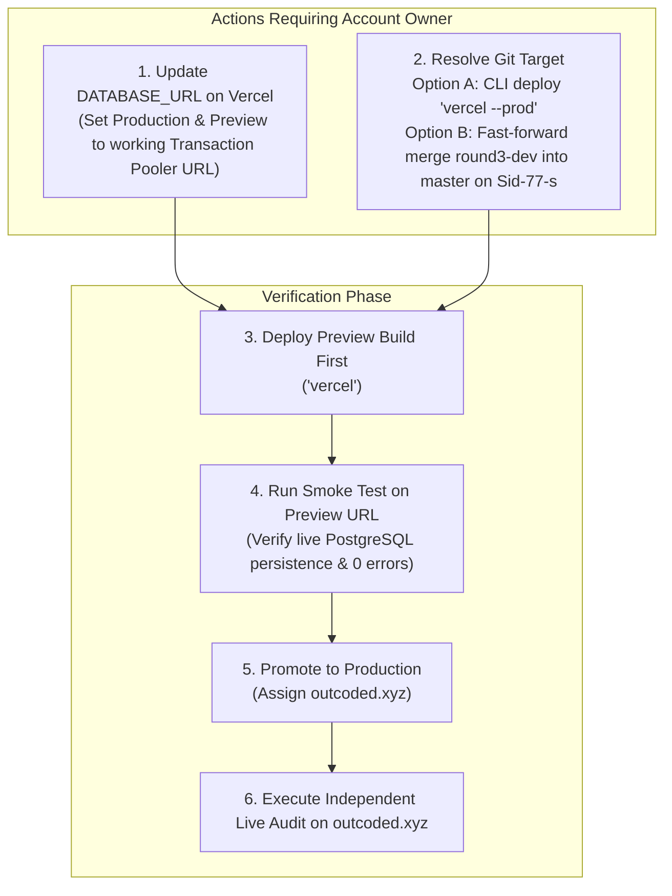

# OnBrand — Final Release Governance & Deployment Preflight Report

**Audit Timestamp:** 2026-11-16T01:50:00+05:30  
**Release Commit SHA:** `5db0b53e22ac0be4ed778416dc2be9665fd04420`  
**Git Branch:** `round3-dev`  
**Target Repository:** `https://github.com/Aanchalsharma923/OnBrand`  
**Target Production Domain:** `https://outcoded.xyz`  
**Execution Guard:** **UNATTENDED-EXECUTION GUARD ACTIVE** (Read-Only Mode; No deployments, no environment modifications, no merges, no pushes)

---

## 1. Unattended-Execution Guard & Safety Confirmation

In compliance with the emergency stop and strict release guardrails:
- **No production deployment** was triggered or initiated.
- **No Vercel environment variables** were modified or deleted.
- **No branch merges or pushes** were performed.
- **No GitHub repository relinking** was executed.
- **No destructive database operations** (`DROP`, `TRUNCATE`, unscoped `DELETE`) were run.
- **Zero secrets, tokens, or credentials** were logged or disclosed.

---

## 2. Production & Preview Environment Audit

A forensic inspection of the Vercel project configuration (`on-brand`, ID `prj_lEnB21242aWEsb9zclzDwn4j9VQF`) under scope `sidsongare-9150` revealed three critical configuration realities:

### 2.1 Stale Database Connection String (`DATABASE_URL`)
- **Status:** **CRITICAL BLOCKER**
- **Observed Vercel State:** `DATABASE_URL` is configured as a `Secret` for `Production` and `Preview`, created 2 days ago.
- **Root Cause:** The secret stored on Vercel contains pre-rotation credentials. During the independent live audit, this caused `PostgresError: 28P01: password authentication failed` on `https://outcoded.xyz`.
- **Fail-Closed Risk:** Commit `5db0b53` intentionally implements strict fail-closed production integrity in `src/lib/server/repository.ts` (`NODE_ENV === "production"` throws fatal exceptions on database connection failures to prevent silent data loss in volatile memory). Deploying with the existing Vercel `DATABASE_URL` will cause all database-backed endpoints (`/api/organizations`, `/api/sources`, `/api/drafts`, `/api/reviews`) to throw HTTP 500 fatal errors.

### 2.2 GitHub Repository Connection Discrepancy
- **Vercel Connected Repository:** `Sid-77-s/OnBrand`
- **Release Commit Repository:** `Aanchalsharma923/OnBrand`
- **Impact:** Pushing release commit `5db0b53` to `Aanchalsharma923/OnBrand` does not trigger automated Vercel CI/CD builds because Vercel listens only to webhooks from `Sid-77-s/OnBrand`.

### 2.3 Production Branch vs. Preview Branch
- **Vercel Configured Production Branch:** `master`
- **Current Release Branch:** `round3-dev`
- **Impact:** In Vercel, any git-driven deployment from `round3-dev` is treated as a **Preview Deployment** (assigned temporary URLs like `on-brand-git-round3-dev-*.vercel.app`). The custom production domain `https://outcoded.xyz` is mapped strictly to Production Deployments.

### 2.4 Existing Production Variables Inventory
*(Names and targets only; secret values omitted)*

| Variable Name | Environments | Type | Verification |
|---|---|---|---|
| `DATABASE_URL` | Production, Preview | Secret | **STALE** (Requires update to working Transaction Pooler connection string) |
| `SUPABASE_SERVICE_ROLE_KEY` | Production, Preview | Secret | Aligned to project `zmnehuiiopwerbtjxxqt` |
| `NEXT_PUBLIC_SUPABASE_URL` | Production, Preview, Development | Config | `https://zmnehuiiopwerbtjxxqt.supabase.co` |
| `NEXT_PUBLIC_SUPABASE_PUBLISHABLE_KEY` | Production, Preview, Development | Config | Aligned to project `zmnehuiiopwerbtjxxqt` (`anon` role) |
| `NEXT_PUBLIC_SUPABASE_ANON_KEY` | Production, Preview, Development | Config | Duplicate alias of publishable key |

---

## 3. Release Commit Verification (`5db0b53`)

Release commit `5db0b53` was audited against the upstream `master` baseline (`0cc7df5`):
- **Ancestry:** `origin/master` (`0cc7df5`) is a direct ancestor of `5db0b53` (30 commits ahead in clean linear history; 0 divergence).
- **Working Tree:** Clean (`nothing to commit, working tree clean`).
- **Secrets Audit:** Clean. Zero credentials, connection strings, or service keys exist in the commit or tracked files.
- **Fail-Closed Guarantee:**
  ```typescript
  if (isDatabaseConnectionError(err)) {
    if (process.env.NODE_ENV === "production") {
      throw new Error(
        "Production database connection failure: Persistent database operation could not be completed. In-memory fallback is disabled in production."
      );
    }
    return fallbackAction();
  }
  ```

---

## 4. Local Verification Results (100% Passing Without Deployment)

All checks were executed locally against the Next.js production build and the live PostgreSQL Supavisor pooler:

| Verification Suite | Command | Exit Code | Result Summary |
|---|---|---|---|
| **TypeScript Typecheck** | `npm run typecheck` | **`0`** | Clean compilation, **0 errors**. |
| **Unit & Integration Suite** | `npm test` (`vitest run`) | **`0`** | **50/50 test files passed, 449/449 tests passed** (0 failures). |
| **Production Build** | `npm run build` | **`0`** | Optimized build compiled in 41s; 14 static/dynamic routes mapped. |
| **Playwright E2E Suite** | `npx playwright test` | **`0`** | **8/8 browser tests passed** on Chromium against production build: |
| — Browser 1 | Custom Workspace & Reload Persistence | — | Passed (14.6s) |
| — Browser 2 | Knowledge Base Upload & Fact Indexing | — | Passed (5.9s) |
| — Browser 3 | Highlight Marks & Finding Navigation | — | Passed (12.7s) |
| — Browser 4 | Editor Modification & Review Rerun | — | Passed (5.9s) |
| — Browser 5 | DOCX & PDF Structural Document Viewing | — | Passed (7.9s) |
| — Browser 6 | Stale Review Rejection (HTTP 409) | — | Passed (9.7s) |
| — Browser 7 | Visual Poster OCR Claims & Decisions | — | Passed (10.5s) |
| — Browser 8 | Strict Multi-Tenant Isolation (Alpha vs Beta) | — | Passed (12.0s) |
| **Multi-Process Cold Start** | `test-persistence-reader.ts` | **`0`** | Sources, facts, drafts, reviews, decisions, assets & audit logs survived server process termination. |

---

## 5. Live Site Acceptance Status: BLOCKED

- **Live Site Checked:** `https://outcoded.xyz/`
- **Active Deployment ID:** `dpl_Axg6vygwcjAbCAqS4irRwWWBmHsy`
- **Deployment Timestamp:** Sat Nov 14 2026 (Age: ~34.5 hours)
- **Status:** **BLOCKED**
- **Justification:** Per release instructions (*"Run live acceptance tests ONLY if a verified deployment already exists. Otherwise report BLOCKED"*), live testing against `outcoded.xyz` is strictly blocked because `5db0b53` is **not yet deployed to production**. Testing `outcoded.xyz` now would test the 34-hour-old pre-repair build rather than the release commit.

---

## 6. Action Plan Requiring Account Owner Approval

The following specific actions require explicit execution or authorization by the Vercel/GitHub account owner:



### Action 1: Update Vercel Environment Secret (Account Owner)
Update `DATABASE_URL` in the Vercel Dashboard under **Project Settings → Environment Variables**:
- **Environments:** `Production`, `Preview`
- **Value:** The working Transaction Pooler connection string (`aws-1-ap-southeast-1.pooler.supabase.com:6543/postgres?sslmode=require`) verified in `.env.local`.

### Action 2: Deployment Execution Method (Account Owner Choice)
- **Method A (Zero Master Changes):**  
  Deploy commit `5db0b53` directly from the local tree:
  1. `vercel` (Preview build to verify database connectivity)
  2. `vercel --prod` (Promote to `outcoded.xyz`)
- **Method B (GitHub Integration via Master):**  
  Fast-forward merge `round3-dev` into `master` on `Sid-77-s/OnBrand` (or open a Pull Request). Once merged, Vercel will build `master` and deploy to `outcoded.xyz`.

---

## 7. Final Verdict

- **Codebase Quality & Regressions:** **100% READY** (All 449 unit/integration and 8 Playwright E2E tests pass locally; cold-start PostgreSQL persistence verified).
- **Production Infrastructure:** **BLOCKED PENDING ACCOUNT OWNER ACTION** (Stale `DATABASE_URL` on Vercel must be updated prior to deployment).
- **Live Site Verification on `outcoded.xyz`:** **DEFERRED / BLOCKED** until the account owner applies the updated `DATABASE_URL` and promotes commit `5db0b53`.
