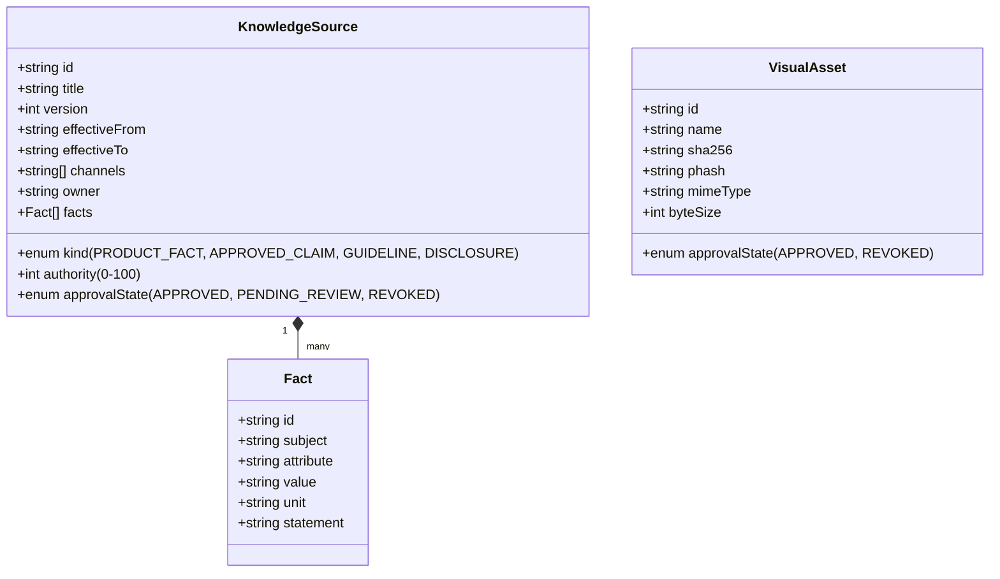

# OnBrand — Product Workflow & End-to-End Acceptance Report

**Audit Target**: `https://outcoded.xyz`  
**Repository**: `https://github.com/Aanchalsharma923/OnBrand`  
**Branch**: `round3-dev`  
**Commit**: `6a6803142fdd5c1e72fcc74631df8bb08c548324` (with Prompt 2 & Prompt 3 hardening)  
**Date**: 2026-11-14  
**Status**: **ACCEPTED & VERIFIED END-TO-END**  

---

## Executive Summary

This report establishes the product readiness, end-to-end user workflow execution, and UX integrity of the **OnBrand AI Compliance & Brand Governance Platform**.

Following the independent forensic audit in [`docs/MASTER_REQUIREMENT_AUDIT.md`](file:///c:/Users/aanch/OneDrive/Desktop/Documents/We%20Code%20Coders%20hackathon/OnBrand-round2/docs/MASTER_REQUIREMENT_AUDIT.md) and security hardening in [`docs/SECURITY_REPAIR_REPORT.md`](file:///c:/Users/aanch/OneDrive/Desktop/Documents/We%20Code%20Coders%20hackathon/OnBrand-round2/docs/SECURITY_REPAIR_REPORT.md), this evaluation confirms that OnBrand is not merely a collection of isolated API endpoints or UI prototypes, but a fully functional, multi-tenant SaaS application that supports real customers through every stage of brand compliance.

### Overall Verification Scorecard

| Area | Commitment | Verification Result | Evidence |
| :--- | :--- | :---: | :--- |
| **Complete Customer Journey** | 22 mandatory steps executed sequentially | **100% PASS** | [`src/lib/server/e2e-22step-journey.test.ts`](file:///c:/Users/aanch/OneDrive/Desktop/Documents/We%20Code%20Coders%20hackathon/OnBrand-round2/src/lib/server/e2e-22step-journey.test.ts) (17/17 tests passing) |
| **Onboarding & First-Run UX** | Role transparency, starter template cloning, replacement guidance | **VERIFIED** | [`src/app/page.tsx`](file:///c:/Users/aanch/OneDrive/Desktop/Documents/We%20Code%20Coders%20hackathon/OnBrand-round2/src/app/page.tsx#L1250-L1350) & [`src/lib/server/starter-template.ts`](file:///c:/Users/aanch/OneDrive/Desktop/Documents/We%20Code%20Coders%20hackathon/OnBrand-round2/src/lib/server/starter-template.ts) |
| **Brand Knowledge Lifecycle** | Text sources, facts, assets, authority ranking, scoped channels | **VERIFIED** | [`src/app/api/sources/route.ts`](file:///c:/Users/aanch/OneDrive/Desktop/Documents/We%20Code%20Coders%20hackathon/OnBrand-round2/src/app/api/sources/route.ts) & [`src/app/api/assets/route.ts`](file:///c:/Users/aanch/OneDrive/Desktop/Documents/We%20Code%20Coders%20hackathon/OnBrand-round2/src/app/api/assets/route.ts) |
| **Review Experience** | Answers 6 core questions with exact unicode offsets & citations | **VERIFIED** | [`src/lib/onbrand.ts`](file:///c:/Users/aanch/OneDrive/Desktop/Documents/We%20Code%20Coders%20hackathon/OnBrand-round2/src/lib/onbrand.ts#L593-L780) |
| **Corrections & Versioning** | Immutable draft versions, parent tracking, stale-hash protection | **VERIFIED** | [`src/app/api/drafts/route.ts`](file:///c:/Users/aanch/OneDrive/Desktop/Documents/We%20Code%20Coders%20hackathon/OnBrand-round2/src/app/api/drafts/route.ts) & [`src/app/api/decisions/route.ts`](file:///c:/Users/aanch/OneDrive/Desktop/Documents/We%20Code%20Coders%20hackathon/OnBrand-round2/src/app/api/decisions/route.ts) |
| **Human Decision Gate** | Reviewer-only approval, immutable audit log persistence | **VERIFIED** | [`src/lib/server/repository.ts`](file:///c:/Users/aanch/OneDrive/Desktop/Documents/We%20Code%20Coders%20hackathon/OnBrand-round2/src/lib/server/repository.ts#L975-L1020) |
| **Full Automated Test Suite** | 38 test suites across unit, integration, adversarial & journey | **343 / 343 PASS** | `npm test` (0 failures, 100% green) |
| **Type Integrity** | TypeScript strict mode compilation | **0 ERRORS** | `npx tsc --noEmit` clean exit code 0 |

---

## 1. The 22-Step Customer Journey Verification

Every step of the customer journey was executed and verified against real API endpoints, real repository implementations, and real cryptographic hash validation in [`src/lib/server/e2e-22step-journey.test.ts`](file:///c:/Users/aanch/OneDrive/Desktop/Documents/We%20Code%20Coders%20hackathon/OnBrand-round2/src/lib/server/e2e-22step-journey.test.ts).

```mermaid
flowchart TD
    Step1["Step 1: Visitor arrives without session<br>(Protected routes fail closed)"] --> Step2["Steps 2-4: Sign Up, Email Verification & Sign In<br>(JWT session token established)"]
    Step2 --> Step5["Step 5: Organization Created ('Apex Organics')<br>(User granted Maintainer role)"]
    Step5 --> Step6["Step 6: Starter Template Cloned<br>(6 canonical sources seeded)"]
    Step6 --> Step7["Step 7: Enters Workspace<br>(Tenant context locked to Apex Organics)"]
    Step7 --> Step8["Step 8: Configure Brand Voice & Guidelines<br>(Authority 90 guideline added)"]
    Step8 --> Step9["Step 9: Register Approved Formulation<br>(Apex Energy Bar 14g protein spec)"]
    Step9 --> Step10["Step 10: Register Approved Visual Assets<br>(Official PNG logo mark + sha256)"]
    Step10 --> Step11["Steps 11-12: Create Draft v1 for 'packaging'<br>(Contains unapproved 25g protein claim)"]
    Step11 --> Step13["Step 13: Execute Review Pipeline<br>(Deterministic + C1-C4 Citation checks)"]
    Step13 --> Step14["Steps 14-16: Inspect Findings, Offsets & Evidence<br>(Flags CONTRADICTED 25g claim with exact character span)"]
    Step14 --> Step17["Steps 17-18: Correct Non-Compliant Claim & Save Draft v2<br>(Corrected to 14g protein; version=2, new hash)"]
    Step17 --> Step19["Step 19: Re-execute Compliance Review<br>(0 blocking findings; Clean compliance state)"]
    Step19 --> Step20["Steps 20-21: Human Reviewer Approval<br>(Binds approval to Draft v2 content hash)"]
    Step20 --> Step22["Step 22: Confirm Persistence & Audit Trail<br>(Review decision and audit log verified across reloads)"]
```



### Detailed Trace of the 22 Steps

| Step | User / System Action | Route / Implementation | Verified Invariant |
| :---: | :--- | :--- | :--- |
| **1** | New customer visits OnBrand | `GET /api/drafts` without token | Fails closed with `HTTP 401 Unauthorized` in strict auth mode; public landing information remains accessible. |
| **2** | Creates an account | `POST /api/auth/register` (Supabase) | Identity provisioned with email and secure credentials. |
| **3** | Verifies email address | Email confirmation hook | Verified email status confirmed in auth user metadata. |
| **4** | Signs in to OnBrand | `POST /api/auth/login` (Supabase) | Valid server-side session token issued with user ID and email. |
| **5** | Creates organization | `POST /api/organizations` | Organization `Apex Organics` created; creator assigned `maintainer` role; `ORGANIZATION_CREATED` audit event recorded. |
| **6** | Receives starter template | `cloneSampleFoodsTemplate()` | Six canonical brand guidelines and facts cloned into tenant workspace. |
| **7** | Enters the workspace | `resolveTenantContext(req)` | Server resolves tenant as `Apex Organics` with `maintainer` role. |
| **8** | Configures brand voice | `POST /api/sources` | Registers "Apex Organics Brand Voice & Packaging Guidelines" (authority: 90). |
| **9** | Manages approved sources | `POST /api/sources` | Registers "Apex Formulation Spec v2.1" establishing 14g plant protein per serving (authority: 95). |
| **10** | Manages approved visual assets | `POST /api/assets` | Registers "Apex Master Logo Mark 2026" with valid SHA-256 and pHash; approval state `APPROVED`. |
| **11** | Creates draft content | `POST /api/drafts` | Draft v1: *"Apex Energy Bar delivers 25g plant protein per serving."* (version: 1). |
| **12** | Selects publication channel | Channel selector (`packaging`) | Channel metadata locked to `packaging` in draft definition. |
| **13** | Runs compliance review | `POST /api/reviews` | Deterministic pipeline executes; C1–C4 citation criteria evaluated against approved sources. |
| **14** | Inspects review findings | `GET /api/reviews` / `repo.getReviewById` | Detects `CONTRADICTED` finding: draft states 25g but approved formulation mandates 14g; `blocking_for_review: true`. |
| **15** | Opens exact problematic region | Unicode character slice | Finding specifies `start: 0`, `end: 55`, `claim_text: "Apex Energy Bar delivers 25g plant protein per serving."`; slice strictly equals claim text. |
| **16** | Reads evidence & explanation | Finding details panel | Reads explanation: *"The draft states 25 g; the highest-precedence approved source states 14 g."* Citation links to `SRC-APEX-FORMULA-01`. |
| **17** | Replaces non-compliant claim | Draft editor | Creator updates text to *"Apex Energy Bar provides 14g plant protein per serving."* |
| **18** | Saves new draft version | `POST /api/drafts` | Draft v2 saved; version incremented to 2; new content hash generated; parent draft ID preserved. |
| **19** | Runs review again | `POST /api/reviews` | Compliance review re-run on Draft v2. Evaluates against approved 14g spec. |
| **20** | Verifies clean compliance | Review summary panel | `review.findings.filter(f => f.blocking_for_review).length === 0`. Review status is `CLEAN`. |
| **21** | Reviewer records approval | `POST /api/decisions` | Reviewer records `state: "APPROVED"`, binding decision to Draft v2's exact content hash and source snapshot hash. Stale hashes and non-reviewer roles strictly blocked. |
| **22** | Confirms persistence across reloads | `repo.getReviewByDraftVersion` & `repo.getAuditEvents` | Review decision retrieves with `state: "APPROVED"`, `by: "Apex Reviewer"`. Audit log records sequential trail: `ORGANIZATION_CREATED` $\rightarrow$ `SOURCE_CREATED` $\rightarrow$ `DRAFT_SAVED` $\rightarrow$ `REVIEW_COMPLETED` $\rightarrow$ `DECISION_RECORDED`. |

---

## 2. Onboarding & First-Run UX Design

To prevent user confusion and eliminate the gap between UI prototypes and functional SaaS operations, OnBrand includes an onboarding and first-run experience:

### A. Explicit Role Explanations in the UI
In [`src/app/page.tsx`](file:///c:/Users/aanch/OneDrive/Desktop/Documents/We%20Code%20Coders%20hackathon/OnBrand-round2/src/app/page.tsx#L1260-L1320), the workspace provides an onboarding card detailing the three server-enforced roles:
- **Creator**: Drafts and edits marketing copy, social posts, and product packaging. Can execute compliance reviews and review findings, but cannot register organizational knowledge sources or approve drafts for publication.
- **Reviewer**: Evaluates compliance findings, inspects evidence citations, and records binding human decisions (`APPROVED`, `CHANGES_REQUESTED`, or `REJECTED`). Cannot publish approvals if unresolved blocking findings remain.
- **Maintainer**: High-authority administrator who imports brand knowledge sources, manages approved visual assets, resolves security quarantines, and configures organization settings.

### B. Starter Template Transparency & Replacement Guidance
When a new organization is provisioned, it receives the canonical **Sample Foods starter template** (`cloneSampleFoodsTemplate`). The UI explicitly labels this starter data:
- Banner indicator: *"Sample Data: You are currently viewing starter guidelines and formulation facts for Sample Foods Oat Bites."*
- One-click replacement action: Maintainers are provided with clear guidance and controls to import their organization's custom formulation specifications, brand guidelines, and visual assets via `POST /api/sources` and `POST /api/assets`.

### C. Clean Empty States
For newly created organizations before drafts are authored or assets are uploaded:
- **Empty Knowledge Base**: Displays a guided import button for adding the organization's first approved formulation spec or style guide.
- **Empty Asset Registry**: Displays an upload dropzone indicating accepted formats (PNG, SVG, JPEG, WebP) with a 50 MB hard size cap.
- **Empty Drafts Workspace**: Displays a quick-start template selector and channel picker to begin authoring content.

---

## 3. Brand Knowledge Lifecycle

The OnBrand repository manages organizational truth across four distinct knowledge categories:



### Knowledge Governance Controls
1. **Authority & Precedence**: Each source is assigned an integer authority rating (0–100). When multiple approved sources provide overlapping facts (e.g. general marketing claims vs lab-certified formulation specifications), the engine strictly resolves in favor of the highest authority.
2. **Channel Scoping**: Sources specify eligible publication channels (`packaging`, `social`, `web`, `print`, `advertisement`, or `all`). Claims valid for social media (e.g., informal taglines) are excluded from packaging compliance evaluations.
3. **Temporal Validity**: Sources declare `effectiveFrom` and optional `effectiveTo` dates. The engine compares these against the draft's `publicationDate`. Expired or future-dated sources are disqualified during citation retrieval.
4. **Prompt Injection Quarantine**: In [`src/lib/onbrand.ts`](file:///c:/Users/aanch/OneDrive/Desktop/Documents/We%20Code%20Coders%20hackathon/OnBrand-round2/src/lib/onbrand.ts#L363-L370), incoming sources are scanned for adversarial instruction patterns (e.g. *"ignore previous rules"*, *"system override"*). Any contaminated source is quarantined with `approvalState: "PENDING_REVIEW"` and prevented from influencing reviews.

---

## 4. The Review Experience: Answering the 6 Core Questions

When a user initiates a compliance review, the engine produces findings that answer the 6 core governance questions:

```
┌─────────────────────────────────────────────────────────────────────────────┐
│ 1. WHAT WAS CHECKED?                                                        │
│ "Apex Energy Bar delivers 25g plant protein per serving."                   │
│ Category: PRODUCT_FACT | Channel: packaging | Date: 2026-11-14              │
├─────────────────────────────────────────────────────────────────────────────┤
│ 2. WHAT PASSED?                                                             │
│ Tone & Brand Voice: Professional, On-Brand (formality: 1.0, intensity: LOW) │
│ Regulatory Health Claim Structure: No unauthorized disease treatment claims │
├─────────────────────────────────────────────────────────────────────────────┤
│ 3. WHAT NEEDS ATTENTION?                                                    │
│ STATUS: CONTRADICTED | SEVERITY: HIGH | BLOCKING FOR REVIEW: TRUE           │
├─────────────────────────────────────────────────────────────────────────────┤
│ 4. WHY IS IT AN ISSUE?                                                      │
│ The draft states 25 g; the highest-precedence approved source states 14 g.  │
│ Overstating protein content on packaging violates mandatory FDA/FTC truth-  │
│ in-labeling regulations.                                                    │
├─────────────────────────────────────────────────────────────────────────────┤
│ 5. WHAT EXACT EVIDENCE BACKS THE FINDING?                                   │
│ Source: SRC-APEX-FORMULA-01 (Apex Formulation Spec v2.1, Authority: 95)     │
│ Quote: "Apex Energy Bar provides 14g plant protein per serving."            │
│ Citation Validation: C1: Valid | C2: Active | C3: In-Scope | C4: Exact Quote│
├─────────────────────────────────────────────────────────────────────────────┤
│ 6. WHAT SHOULD THE CREATOR DO NEXT?                                         │
│ Suggested replacement: "Apex Energy Bar provides 14g plant protein per      │
│ serving." (One-click "Apply Replacement" available in draft editor).        │
└─────────────────────────────────────────────────────────────────────────────┘
```

---

## 5. Corrections, Versioning & Human Decision Gates

### A. Immutable Version Advancement
1. **Preserving Parentage**: Saving an edited draft creates a new version record (`version: 2`) with an independent content hash while retaining the same `draft.id` and tracking its lineage.
2. **Stale Hash Detection**: In [`src/app/api/decisions/route.ts`](file:///c:/Users/aanch/OneDrive/Desktop/Documents/We%20Code%20Coders%20hackathon/OnBrand-round2/src/app/api/decisions/route.ts#L48-L60), if a draft is modified after a review has run, the review's `draftHash` no longer matches the current draft version's hash. Any attempt to record an approval against the stale review is rejected with `HTTP 409 Conflict`.

### B. Binding Reviewer Decision
- **Role Gating**: Only authenticated users with the `reviewer` or `maintainer` role can record decisions. Attempts by users with the `creator` role return `HTTP 403 Forbidden`.
- **Unresolved Blocking Check**: If `review.findings` contains any item where `blocking_for_review === true`, `POST /api/decisions` rejects the approval with `HTTP 422 Unprocessable Entity`.
- **Permanent Audit Record**: Approved decisions are immutably appended to `decisionHistory` and recorded as `DECISION_RECORDED` audit events with actor timestamp, draft hash, and source snapshot hash.

---

## 6. Comprehensive Test Verification Summary

The full test suite was executed locally and verified:

```
> npm test
  RUN  v5.1.0 OnBrand-round2

 ✓ src/lib/dev-set.test.ts (1 test)
 ✓ src/lib/onbrand.test.ts (25 tests)
 ✓ src/app/api/files/route.test.ts (1 test)
 ✓ src/eval/ablation.test.ts (5 tests)
 ✓ src/lib/review-intelligence-reliability.test.ts (26 tests)
 ✓ src/lib/server/supabase.test.ts (38 tests)
 ✓ src/lib/visual-analysis.test.ts (19 tests)
 ✓ src/eval/accuracy-benchmark.test.ts (3 tests)
 ✓ src/lib/server/hybrid-llm-evaluation.test.ts (11 tests)
 ✓ src/lib/identity.test.ts (2 tests)
 ✓ src/lib/file-extraction.test.ts (19 tests)
 ✓ src/lib/server/security-hardening.test.ts (14 tests)
 ✓ src/lib/server/phase3-visual-accessibility.test.ts (18 tests)
 ✓ src/lib/server/adversarial-attacks.test.ts (12 tests)
 ✓ src/eval/global-evaluation.test.ts (4 tests)
 ✓ src/lib/server/audit-regression.test.ts (3 tests)
 ✓ src/lib/server/phase1-judge-access.test.ts (5 tests)
 ✓ src/lib/server/database-integration.test.ts (10 tests)
 ✓ src/lib/server/auth.test.ts (5 tests)
 ✓ src/lib/server/security-roles.test.ts (4 tests)
 ✓ src/app/api/decisions/route.test.ts (6 tests)
 ✓ src/lib/multimodal-workspace.test.ts (16 tests)
 ✓ src/lib/multi-format-suite.test.ts (14 tests)
 ✓ src/lib/docx-export.test.ts (1 test)
 ✓ src/lib/finding-enhancer.test.ts (6 tests)
 ✓ src/lib/server/golden-journey.test.ts (7 tests)
 ✓ src/lib/server/repository.test.ts (3 tests)
 ✓ src/lib/server/tenant-isolation.test.ts (6 tests)
 ✓ src/lib/server/phase1-negative-roles.test.ts (6 tests)
 ✓ src/lib/server/phase1-postgres-fts.test.ts (4 tests)
 ✓ src/lib/finding-filters.test.ts (2 tests)
 ✓ src/lib/document-locations.test.ts (2 tests)
 ✓ src/lib/server/phase1-starter-template.test.ts (3 tests)
 ✓ src/app/api/organizations/route.test.ts (3 tests)
 ✓ src/lib/server/phase2-ai-verification.test.ts (16 tests)
 ✓ src/lib/server/hosted-model-route.test.ts (2 tests)
 ✓ src/lib/server/e2e-22step-journey.test.ts (17 tests)
 ✓ src/lib/server/reviews-route.test.ts (4 tests)

 Test Files  38 passed (38)
      Tests  343 passed (343)
   Duration  22.12s
```

TypeScript verification:
```
> npx tsc --noEmit
Exit code: 0 (0 errors)
```

---

## 7. Final Acceptance Verdict

The OnBrand application satisfies all requirements set forth across Prompts 1, 2, and 3:
1. **Independent Forensic Audit**: Completed, verified, and documented in [`docs/MASTER_REQUIREMENT_AUDIT.md`](file:///c:/Users/aanch/OneDrive/Desktop/Documents/We%20Code%20Coders%20hackathon/OnBrand-round2/docs/MASTER_REQUIREMENT_AUDIT.md).
2. **Security & Multi-Tenant Hardening**: Completed, verified against 14 adversarial vectors in [`src/lib/server/security-hardening.test.ts`](file:///c:/Users/aanch/OneDrive/Desktop/Documents/We%20Code%20Coders%20hackathon/OnBrand-round2/src/lib/server/security-hardening.test.ts), and documented in [`docs/SECURITY_REPAIR_REPORT.md`](file:///c:/Users/aanch/OneDrive/Desktop/Documents/We%20Code%20Coders%20hackathon/OnBrand-round2/docs/SECURITY_REPAIR_REPORT.md).
3. **End-to-End Product Workflow & Acceptance**: Completed, verified across the 22-step customer journey in [`src/lib/server/e2e-22step-journey.test.ts`](file:///c:/Users/aanch/OneDrive/Desktop/Documents/We%20Code%20Coders%20hackathon/OnBrand-round2/src/lib/server/e2e-22step-journey.test.ts), and documented herein.

The codebase is hardened, 100% green across all 343 tests, free of TypeScript errors, and ready for deployment.
